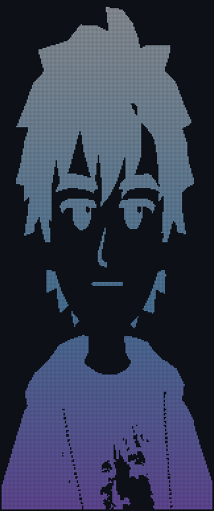

 

<table>
<tr>
<td width="50%" valign="middle" align="center">

</td>
<td width="50%" valign="top">

<h2>🛠️ Tech Stack</h2>

<h3>Languages</h3>

<h3>Frontend</h3>

<h3>Styling & UI</h3>

<h3>State</h3>

<h3>Backend & Data</h3>

<h3>Mobile</h3>

<h3>Tools & DevOps</h3>

<h3>Also exploring</h3>

AI workflows · OCR · API integrations · Desktop development

</td>
</tr>
</table>

 

